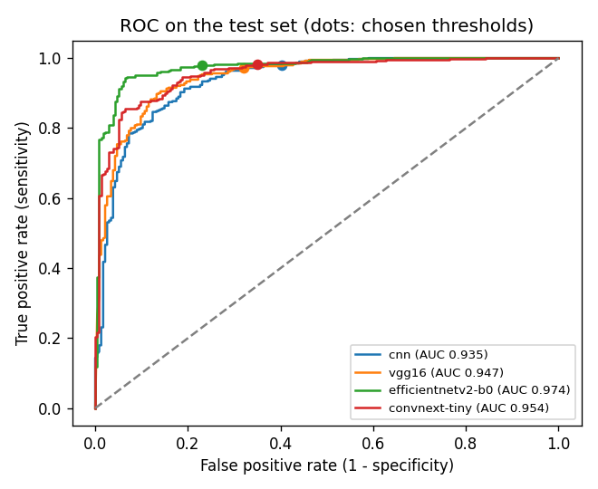
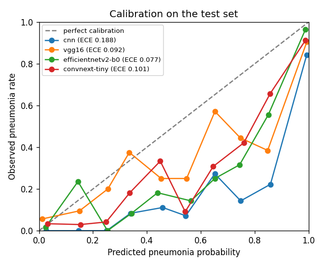
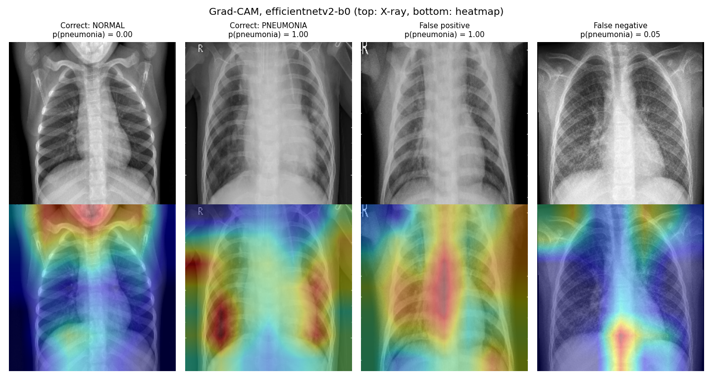
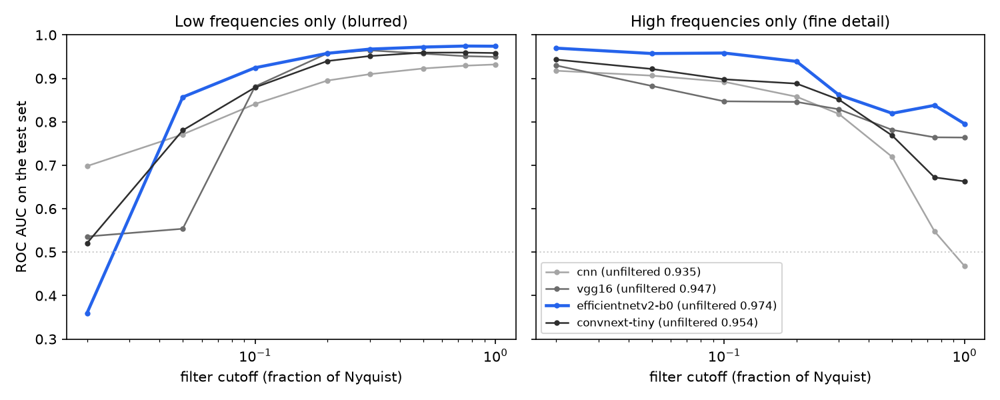
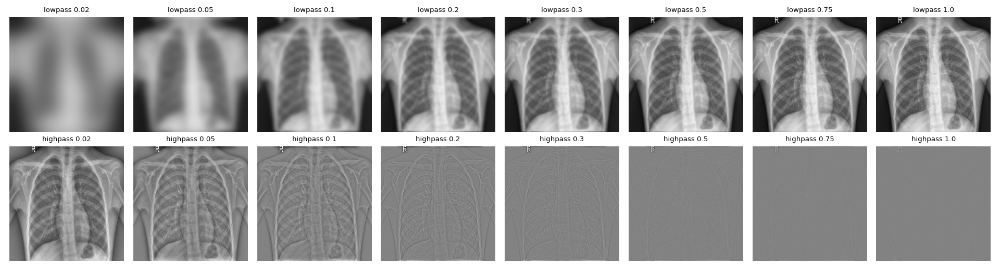

# Chest X‑Ray Pneumonia Classification

Convolutional neural networks (CNNs) that classify chest X‑ray images as **Normal** (healthy) or **Pneumonia**. The code is a small Python package, `xray_classifier`, with command-line tools for training, evaluation, and prediction, a notebook that walks through the whole workflow, and a web demo.

> **Research and education only.** This project is not a medical device and must not be used to diagnose patients.

---

## 📖 Table of Contents

1. [About](#about)
2. [Project Structure](#project-structure)
3. [Prerequisites](#prerequisites)
4. [Project Setup](#project-setup)

   * [Clone Repository](#clone-repository)
   * [Install Dependencies](#install-dependencies)
   * [Download Dataset](#download-dataset)
   * [Development Setup](#development-setup)
5. [Usage](#usage)

   * [Command Line](#command-line)
   * [Notebook](#notebook)
   * [Demo App](#demo-app)
   * [Browser Demo](#browser-demo)
   * [Configuration](#configuration)
6. [Results](#results)
7. [Testing](#testing)
8. [Contributing](#contributing)
9. [License](#license)

---

## About

The project trains and compares models on the public [Chest X‑Ray Pneumonia dataset](https://www.kaggle.com/datasets/paultimothymooney/chest-xray-pneumonia):

| Model (`--model`) | Input | Description |
| --- | --- | --- |
| `cnn` | 100x100 grayscale | Three Conv2D + MaxPooling + Dropout blocks, trained from scratch |
| `vgg16` | 100x100 RGB | Frozen ImageNet VGG16 base with a dense head |
| `efficientnetv2-b0` | 224x224 RGB | Frozen ImageNet EfficientNetV2-B0 base with a pooled linear head |
| `convnext-tiny` | 224x224 RGB | Frozen ImageNet ConvNeXt-Tiny base with a pooled linear head |

Each pretrained model has its ImageNet input preprocessing built in, so every model takes images scaled to [0, 1].

How training works:

* **Validation split by patient.** The dataset's `val/` folder has only 16 images, too few to steer training. By default `train/` and `val/` are pooled and 15% is held out for validation, stratified by class and grouped by the patient ID in the filenames (`person123_...`, `IM-0115-...`), so no patient appears in both training and validation.
* **Class weights.** The training set has about three PNEUMONIA images for every NORMAL one. The loss is weighted so both classes count equally.
* **Callbacks.** Early stopping, learning-rate reduction on plateau, and a checkpoint of the best model (lowest validation loss) in `.keras` format.
* **Calibrated threshold.** After training, the decision threshold that maximizes sensitivity + specificity on the validation split is saved next to the model as `<model>.json`. Evaluation and prediction use it automatically.
* **Optional fine-tuning.** For pretrained models, a second phase can unfreeze the backbone's last stage and train it at a low learning rate. The checkpoint is only replaced if fine-tuning improves the validation loss.

Evaluation reports accuracy, **sensitivity** (share of pneumonia cases caught), **specificity** (share of normal cases cleared), ROC AUC, a classification report, and a confusion matrix. It also reports **calibration** (Brier score and expected calibration error, with a reliability diagram) and **95% confidence intervals** from a bootstrap that resamples whole patients, so several images of one patient do not count as independent evidence. **Grad-CAM** heatmaps show which image regions drive a prediction, to check that a model looks at the lungs rather than at shortcuts such as text markers or image borders.

## Project Structure

```
.
├── X_ray_Image_Classification.ipynb   # walkthrough notebook (Colab-ready)
├── src/xray_classifier/
│   ├── config.py      # class names, image size, data and model paths
│   ├── data.py        # file listing, patient-grouped split, tf.data pipeline
│   ├── models.py      # model builders and fine-tuning (unfreeze last stage)
│   ├── train.py       # training with callbacks and threshold calibration (xray-train)
│   ├── thresholds.py  # choosing, saving, and loading decision thresholds
│   ├── evaluate.py    # metrics on a data split (xray-evaluate)
│   ├── predict.py     # single-image prediction (xray-predict)
│   ├── gradcam.py     # Grad-CAM heatmaps
│   ├── plots.py       # training curves, confusion matrix, ROC, reliability, Grad-CAM figures
│   ├── report.py      # results table and comparison figures for several models (xray-report)
│   ├── spectral.py    # spectral ablation: AUC on low-/high-pass filtered images (xray-spectral)
│   ├── export.py      # ONNX export with a class-activation-map output (xray-export)
│   └── app.py         # Gradio web demo (xray-app)
├── web/               # in-browser demo: Rust + tract compiled to WebAssembly, static page
├── docs/              # results table and figures shown below
├── space/             # Hugging Face Space entry point and example images
├── tests/             # pytest suite, runs on small synthetic datasets
├── .github/workflows/ # CI: pre-commit and pytest
└── pyproject.toml     # package metadata, dependencies, tool config
```

## Prerequisites

* **Python 3.10+**
* A **Kaggle account** and API token, to download the dataset
* A GPU is recommended for the pretrained models, especially at 224x224

## Project Setup

### Clone Repository

```bash
git clone https://github.com/sathvik8317/X-ray-Image-Classification.git
cd X-ray-Image-Classification
```

### Install Dependencies

Create a virtual environment (recommended) and install the package:

```bash
python -m venv venv
source venv/bin/activate      # macOS/Linux
venv\Scripts\activate         # Windows

pip install -r requirements.txt
```

This installs `xray_classifier` in editable mode along with its dependencies (TensorFlow, NumPy, Matplotlib, scikit-learn, Kaggle), which are listed in `pyproject.toml`. For the web demo, also run `pip install -e ".[app]"`.

### Download Dataset

1. Place your Kaggle API token (`kaggle.json`) in `~/.kaggle/`.
2. Run:

   ```bash
   kaggle datasets download -d paultimothymooney/chest-xray-pneumonia -p ./data --unzip
   ```
3. After extraction, the folder structure should be:

   ```
   data/chest_xray/
   ├── train/
   │   ├── NORMAL/
   │   └── PNEUMONIA/
   ├── val/
   │   ├── NORMAL/
   │   └── PNEUMONIA/
   └── test/
       ├── NORMAL/
       └── PNEUMONIA/
   ```

You can also download the zip manually from the [Kaggle dataset page](https://www.kaggle.com/datasets/paultimothymooney/chest-xray-pneumonia) and unzip it into `data/`.

### Development Setup

For contributors, install the dev tools and enable the git hooks:

```bash
pip install -r requirements-dev.txt
pre-commit install
```

The hooks run [Ruff](https://docs.astral.sh/ruff/) (lint and format) on the code and notebook, strip execution counts and transient metadata from the notebook with `nbstripout` (outputs are kept), and block accidentally committed large files. Run them manually with `pre-commit run --all-files`.

Never commit `kaggle.json`, the dataset, or trained model files. They are listed in `.gitignore`.

## Usage

### Command Line

Train a model. The best checkpoint is saved to `models/<model>.keras` and its threshold to `models/<model>.json`:

```bash
xray-train --model cnn
xray-train --model vgg16
xray-train --model efficientnetv2-b0 --fine-tune-epochs 5
```

| Option | Default | Description |
| --- | --- | --- |
| `--epochs` | 10 | Epochs of the main (frozen-base) phase |
| `--batch-size` | 4 for `cnn`, 32 otherwise | |
| `--img-size` | 100 for `cnn`/`vgg16`, 224 otherwise | |
| `--augment/--no-augment` | off for `cnn`, on otherwise | Small random rotation (±10°), shift (±5%), zoom (±15%), brightness and contrast. No horizontal flips: they would put the heart on the wrong side |
| `--val-fraction` | 0.15 | Share held out for validation, split by patient; `0` uses the provided 16-image `val/` folder |
| `--class-weight/--no-class-weight` | on | Balance NORMAL and PNEUMONIA in the loss |
| `--fine-tune-epochs` | 0 | Extra epochs training the backbone's last stage (pretrained models only) |
| `--fine-tune-lr` | 1e-5 | Learning rate for fine-tuning |
| `--seed` | none | Seed for shuffling, augmentation, and weight initialization |
| `--split-seed` | 0 | Seed choosing the validation patients; fixed by default so runs are compared on the same patients |

Evaluate a trained model on the test set, optionally saving the plots (confusion matrix, ROC curve, reliability diagram) and the metrics as JSON. It prints 95% confidence intervals from 1,000 patient-level bootstrap resamples (`--bootstrap 0` skips them), and warns if patients in the evaluated split also appear in `train/`:

```bash
xray-evaluate models/vgg16.keras --plots-dir reports/ --json reports/vgg16.json
```

Compare several trained models in one go. This writes the results table (`results.md`, `results.json`), ROC and calibration plots with every model on them, and a Grad-CAM grid of the best model's most confident correct calls and worst mistakes:

```bash
xray-report models/*.keras --out-dir docs/
```

Classify individual images, optionally saving Grad-CAM heatmaps:

```bash
xray-predict models/vgg16.keras path/to/image1.jpeg path/to/image2.jpeg --gradcam reports/gradcam/
```

Both use the threshold saved with the model unless `--threshold` is given.

Check which spatial frequencies a model relies on (see [Spectral ablation](#spectral-ablation-which-frequencies-do-the-models-read)):

```bash
xray-spectral models/efficientnetv2-b0.keras --out-dir docs/
```

Export a model to ONNX for the browser demo, with a second output holding its class activation map (see [Browser Demo](#browser-demo)):

```bash
pip install -e ".[onnx]"
xray-export models/efficientnetv2-b0.keras --out web/model/efficientnetv2-b0.onnx
```

Each command is also available as `python -m xray_classifier.<train|evaluate|predict|report|spectral|export>`.

### Notebook

Open `X_ray_Image_Classification.ipynb` in Jupyter or [Google Colab](https://colab.research.google.com/) and run the cells in order. It explores the data, trains the custom CNN, VGG16, and EfficientNetV2-B0 (with fine-tuning), compares them on the test set, and shows Grad-CAM heatmaps. In Colab, the first cell clones this repository and installs the package; upload `kaggle.json` to the Colab working directory so the download cell can fetch the dataset.

### Demo App

A small web page to upload an X-ray and see the prediction and its Grad-CAM heatmap:

```bash
pip install -e ".[app]"
xray-app models/vgg16.keras          # then open http://127.0.0.1:7860
```

`--examples img1.jpeg img2.jpeg` adds one-click sample images. The `space/` folder runs the same demo on [Hugging Face Spaces](https://huggingface.co/spaces): copy a trained model into it as `model.keras` with its threshold as `model.json`, and upload the folder's contents to a Gradio Space. Its `requirements.txt` installs this package from GitHub.

### Browser Demo

`web/` runs EfficientNetV2-B0 and its heatmap **entirely in the browser**: a Rust crate compiles [tract](https://github.com/sonos/tract) (an ONNX runtime written in Rust) to WebAssembly, so there is no server and the X-ray never leaves the device. It is a static site, so it can be hosted for free on a static Hugging Face Space, GitHub Pages or any file host.

* **Heatmap without gradients.** `xray-export` adds a second output to the ONNX model: the last feature map projected onto the output layer's weights. For a global-average-pooling + single dense layer head, that projection *is* Grad-CAM (every channel's gradient is its weight divided by the map's area). So the browser computes the same heatmap as `xray-predict --gradcam` without any autodiff.
* **Same numbers as Python.** The crate copies `tf.image.resize` (bilinear, half-pixel centers) and matplotlib's `jet` colormap, and a parity test checks its probabilities and maps against Keras on real test images.
* **No JavaScript glue generator.** The wasm module has zero imports and exports a small C ABI (`alloc`, `load`, `classify`, getters); `web/www/worker.js` is all the glue, and inference runs in a Web Worker.

```bash
xray-export models/efficientnetv2-b0.keras --out web/model/efficientnetv2-b0.onnx
web/build.sh web/model/efficientnetv2-b0.onnx     # needs Rust with the wasm32-unknown-unknown target
python -m http.server -d web/www                  # then open http://127.0.0.1:8000
```

Rust tests (unit + parity) run natively with `cargo test`, or under Node's WASI on machines that can't run native test binaries: `cargo test --target wasm32-wasip1 --no-run && node tools/run-wasi-tests.mjs` (from `web/`). The parity test reads `web/fixtures/` (the exported model, its `*_reference.json` and the referenced test images) and is skipped when they are missing.

### Configuration

Paths default to `data/chest_xray` for the dataset and `models/` for checkpoints. Override them with environment variables, for example to point at a mounted Google Drive folder:

```bash
export XRAY_DATA_DIR=/content/drive/MyDrive/Datasets/chest_xray
export XRAY_MODELS_DIR=/content/drive/MyDrive/models
```

## Results

All four models on the 624-image test set (234 NORMAL, 390 PNEUMONIA), which was not used for training, threshold choice, or model selection. Trained on a Kaggle T4 GPU with `--seed 42` and default options, plus 5 fine-tuning epochs for EfficientNetV2-B0 and ConvNeXt-Tiny (37 minutes for all four). Brackets are 95% confidence intervals from 1,000 patient-level bootstrap resamples.

| Model | Sensitivity % | Specificity % | Accuracy % | ROC AUC | ECE | Threshold |
| --- | --- | --- | --- | --- | --- | --- |
| cnn | 97.9 (96.5-99.3) | 59.8 (53.6-65.9) | 83.7 (80.2-86.5) | 0.935 (0.911-0.955) | 0.188 | 0.777 |
| vgg16 | 97.2 (95.4-98.7) | 67.9 (61.9-74.8) | 86.2 (83.2-89.2) | 0.947 (0.929-0.964) | 0.092 | 0.274 |
| **efficientnetv2-b0** | **97.9 (96.4-99.2)** | **76.9 (70.8-82.6)** | **90.1 (87.1-92.5)** | **0.974 (0.960-0.985)** | **0.077** | 0.480 |
| convnext-tiny | 98.2 (96.8-99.5) | 65.0 (58.4-71.6) | 85.7 (82.5-88.8) | 0.954 (0.937-0.969) | 0.101 | 0.389 |

<p align="center">
  
  
</p>

What the numbers show:

* **EfficientNetV2-B0 is the best model.** It catches 382 of 390 pneumonia cases and clears 180 of 234 healthy patients. The original notebook's best test accuracy was 85.9% (VGG16); it is now 90.1%.
* **Pneumonia is easy to catch; clearing healthy patients is hard.** Every model misses at most 11 pneumonia cases but wrongly flags 54 to 94 normal X-rays.
* **Validation scores overstate test performance.** On the patient-grouped validation split, every model reaches 96-99% specificity with a calibration error of 0.02-0.05. On the test set, specificity falls to 60-77% and the calibration error rises to 0.08-0.19. The validation split is drawn from the same pool as training, while `test/` appears to have been collected differently. So the threshold chosen on validation is too low for the test set, and every reliability curve sits below the diagonal: the models are overconfident about pneumonia.
* **Grad-CAM shows signs of shortcut learning.** For the most confident correct NORMAL call, the heatmap covers the neck and the top edge of the image, not the lungs; for the worst missed pneumonia case it sits below the diaphragm. Correct pneumonia calls do look at the lung fields.



### Spectral ablation: which frequencies do the models read?

Each test image is Fourier-filtered to keep only its low frequencies (a blurred X-ray: lung shapes and opacities) or only its high frequencies (fine edges, texture, noise), and ROC AUC is measured again. AUC is used because it does not depend on the decision threshold, which filtering shifts.





* **The pretrained models read pneumonia from texture a human cannot see.** With a high-pass cutoff of 1.0 the X-ray is a flat grey field with faint edges (bottom right above), yet EfficientNetV2-B0 still scores **AUC 0.80** and VGG16 0.76. The custom CNN, trained from scratch on 100-pixel images, falls to chance (0.47) on the same images.
* That signal is most likely in how the images were acquired or compressed (scanner noise, sharpening, JPEG artefacts) rather than in the lungs, since NORMAL and PNEUMONIA images in this dataset were not collected identically. Together with the Grad-CAM heatmaps on the neck and image edges, it is further evidence of shortcut learning, and a likely reason the models over-call pneumonia on the differently collected `test/` set.
* **Coarse structure carries real signal too.** Blurred down to a 5%-of-Nyquist low-pass, where only the outline of the lungs and dense opacities remain, EfficientNetV2-B0 keeps AUC 0.86.
* On an almost featureless blur (low-pass 0.02), EfficientNetV2-B0 drops to 0.36, below chance. Its predictions on such images are driven by something systematically reversed, probably overall brightness or image size, not by pathology.

Reproduce with `xray-spectral models/<model>.keras --out-dir docs/` for each model (a minute per model on a T4), then `xray-spectral --compare docs/*_spectral.json --out-dir docs/`.

To reproduce, train each model with `--seed 42` (adding `--fine-tune-epochs 5` for `efficientnetv2-b0` and `convnext-tiny`), then run `xray-report models/{cnn,vgg16,efficientnetv2-b0,convnext-tiny}.keras --out-dir docs/`. GPU nondeterminism means the numbers can differ slightly between runs.

## Testing

```bash
pip install -r requirements-dev.txt
pytest
```

The tests build small synthetic datasets, so they need neither the Kaggle data nor a GPU (about a minute and a half on a laptop CPU). GitHub Actions runs the pre-commit hooks and the test suite on Python 3.10 and 3.12 for every pull request.

## Contributing

Feel free to fork this repository and submit pull requests for:

* Hyperparameter tuning and comparisons of the models on the real data.
* Evaluation on an external chest X-ray dataset, to check how well the models generalize beyond this one.
* Additional architectures or test-time augmentation.

## License

This project is released under the **Apache License**. See [LICENSE](LICENSE) for details.
